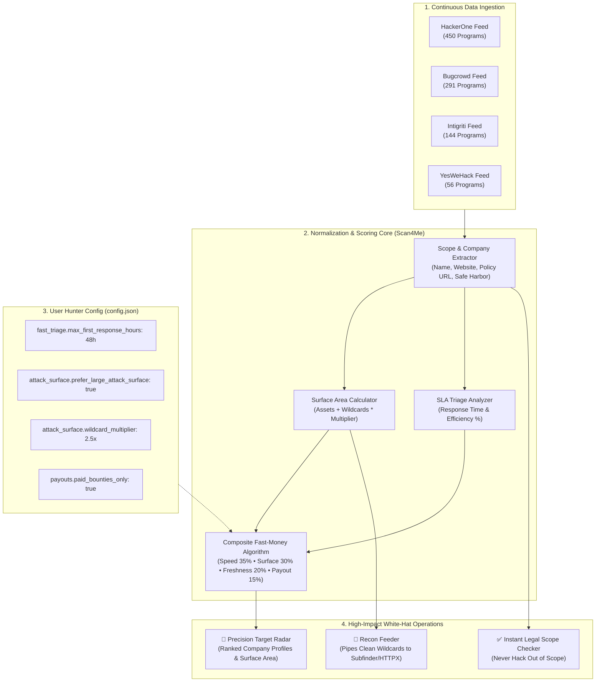

# 🎯 Scan4Me: Precision Bug Bounty Intelligence & Scope Targeter

**Scan4Me** is an automated bug bounty target selection engine built for white-hat hackers who prioritize:
1. **⚡ Fast Triage Speeds**: Security teams that respond in hours (not months), with high response efficiency (>80%).
2. **🌐 Massive Attack Surface**: Companies with extensive scope (`*.domain.com` wildcards and microservices)—**more assets means more surface area to find bugs**.
3. **💰 Fast Cash & High Payouts**: Strict filtering for paid BBP programs and verified bounty pools.
4. **🌿 Low Report Saturation**: Fresh programs and targets with lower past backlog to minimize duplicate submissions.

It indexes over **47,000+ assets** across **HackerOne**, **Bugcrowd**, **Intigriti**, and **YesWeHack** into a local SQLite database that queries in milliseconds offline.

---

## 🗺️ System Architecture



---

## 🚀 Usage Guide

### 1. Synchronize Live Feeds
Sync your local database with upstream intelligence:
```bash
python3 scan4me.py sync
```

### 2. Run Precision Target Radar
Display companies ranked by attack surface size and fast triage SLA:
```bash
python3 scan4me.py radar --limit 10
```

**Sample Output:**
```text
[01] ★ SCORE: 92.8/100 | 🔥 MASSIVE SURFACE | [HackerOne] Flutter UK&I
     🏢 Company Info : Policy: https://hackerone.com/flutteruki
                       Website: https://www.flutter.com/our-business/our-divisions
     ⚡ Triage Speed  : 3.0h (Eff: 94.0%) | 💰 Payout: Paid BBP
     🌐 Surface Scope : 44 In-Scope Assets (36 Wildcards) | Harbor: Standard
     🔎 Target Sample : *.betfair.com, *.betfair.es, *.betfair.it
----------------------------------------------------------------------------------------
[02] ★ SCORE: 92.2/100 | 🔥 MASSIVE SURFACE | [HackerOne] Cloudflare Public Bug Bounty
     🏢 Company Info : Policy: https://hackerone.com/cloudflare
                       Website: https://www.cloudflare.com/disclosure
     ⚡ Triage Speed  : 1.0h (Eff: 86.0%) | 💰 Payout: Paid BBP
     🌐 Surface Scope : 51 In-Scope Assets (3 Wildcards) | Harbor: Standard
     🔎 Target Sample : *.cloudflare.com, *.cloudflarepartners.com, *.teams.cloudflare.com
```

### 3. Verify Legal Scope Before Probing
Check whether a target URL or domain is legally authorized:
```bash
python3 scan4me.py check api.tesla.com
```

### 4. Feed Filtered Targets Straight into Recon Tools
Export clean wildcards for the top ranked programs directly into subdomain enumeration:
```bash
python3 scan4me.py export --top 20 --wildcards-only --clean | subfinder -silent | httpx -title -status-code
```

---

## ⚙️ Configuration (`config.json`)

Tune your hunting criteria:

```json
{
  "filters": {
    "paid_bounties_only": true,
    "fast_triage": {
      "enabled": true,
      "max_first_response_hours": 48.0,
      "min_response_efficiency_pct": 80.0,
      "prefer_managed_triage": true,
      "max_time_to_bounty_awarded_hours": 720.0
    },
    "attack_surface_and_scope": {
      "prefer_large_attack_surface": true,
      "min_in_scope_assets": 1,
      "prioritize_wildcards": true,
      "wildcard_multiplier": 2.5
    },
    "freshness_and_competition": {
      "prefer_fresh_programs": true,
      "low_report_saturation": true
    },
    "payouts": {
      "min_max_payout_usd": 1000.0,
      "prioritize_fast_cash": true
    }
  },
  "platforms": {
    "hackerone": true,
    "bugcrowd": true,
    "intigriti": true,
    "yeswehack": true
  },
  "ranking_weights": {
    "triage_speed": 0.35,
    "attack_surface_size": 0.30,
    "freshness_and_low_saturation": 0.20,
    "payout_size": 0.15
  }
}
```

---

## 🛡️ Responsible Disclosure & Legal Notice

This software is strictly intended for authorized security research and ethical bug bounty hunting. Always adhere to program policies and safe harbor agreements before initiating security testing.
