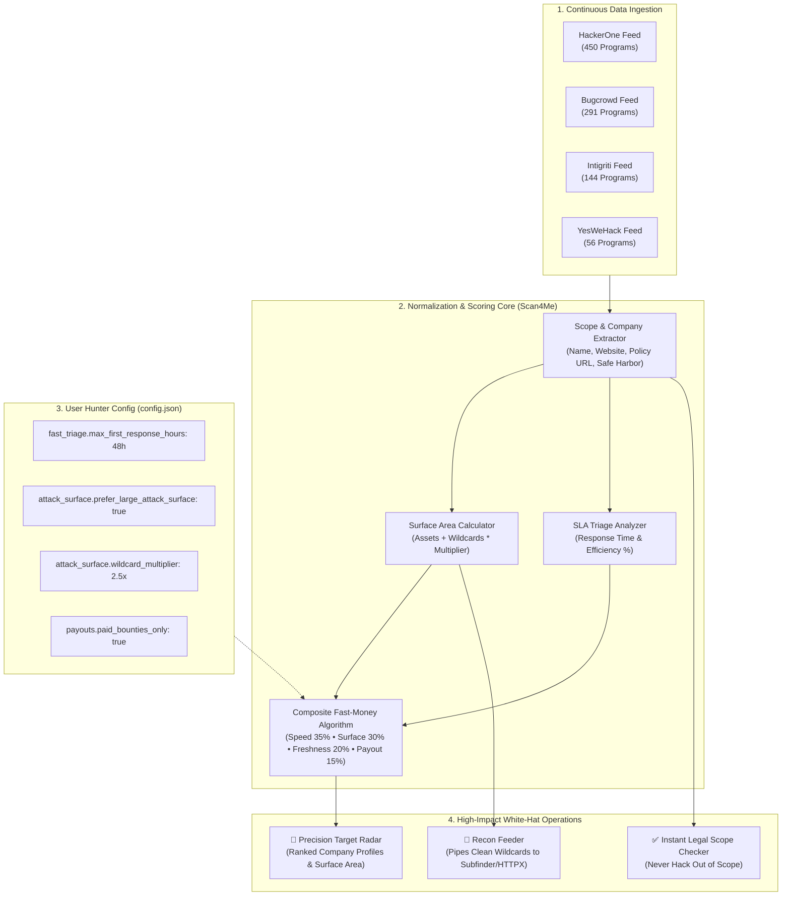

# 🎯 Scan4Me: Precision Bug Bounty Intelligence & Scope Targeter

**Scan4Me** is an automated bug bounty target selection engine built for authorized researchers who prioritize:
1. **⚡ Fast Triage Signals**: Measured average first-response times are available in the HackerOne feed; managed triage on other platforms is not a response-time measurement.
2. **🌐 Massive Attack Surface**: Companies with extensive scope (`*.domain.com` wildcards and microservices)—**more assets means more surface area to find bugs**.
3. **💰 Fast Cash & High Payouts**: Strict filtering for paid BBP programs and verified bounty pools.
4. **🆕 Official Program/Scope History**: Bugcrowd enrichment reads published program start dates and versioned scope history. Other feeds are not labeled with official dates until platform-specific adapters are added.

It indexes programs and assets from **HackerOne**, **Bugcrowd**, **Intigriti**, and **YesWeHack**. Bugcrowd public statistics include rewarded-vulnerability totals, historical average payout, and validation time; those are useful competition/triage signals, but rewarded totals are not counts of open or resolved reports.

---

## 🗺️ System Architecture



---

## 🚀 Usage Guide

### 1. Refresh Feeds and Sync
Fetch the latest upstream snapshot and update the local database:
```bash
python3 scan4me.py sync
```

For offline operation against the last cached snapshot:
```bash
python3 scan4me.py sync --offline
```

The first sync establishes an observation baseline. Use the enrichment command for Bugcrowd's actual program and scope dates:
```bash
python3 scan4me.py enrich --limit 30
```

### 2. Run Precision Target Radar
Display companies ranked by surface and available triage evidence:
```bash
python3 scan4me.py radar --limit 10
```

Filter using official Bugcrowd program/scope dates and its public metrics:
```bash
python3 scan4me.py radar --new-companies --new-company-days 90
python3 scan4me.py radar --new-assets --new-asset-days 30
python3 scan4me.py radar --max-validation-days 14 --max-rewarded-vulnerabilities 100
```

`--new-companies` and `--new-assets` currently use official Bugcrowd start/scope history; platforms without an implemented source adapter are excluded by those filters rather than guessed. `--max-validation-days` uses Bugcrowd's published validation statistic. `--max-rewarded-vulnerabilities` is a historical competition proxy, not a resolved-report count. Use `--require-measured-triage` to require HackerOne first-response data or Bugcrowd validation data.

### 3. Verify Legal Scope Before Probing
Check whether a target URL or domain is legally authorized:
```bash
python3 scan4me.py check api.tesla.com
```

### 4. Feed Filtered Targets Straight into Recon Tools
Export clean wildcards for the top ranked programs directly into subdomain enumeration:
```bash
python3 scan4me.py export --top 20 --wildcards-only --clean | subfinder -silent | httpx -title -status-code
```

---

## ⚙️ Configuration (`config.json`)

Tune your hunting criteria:

```json
{
  "filters": {
    "paid_bounties_only": true,
    "fast_triage": {
      "enabled": true,
      "max_first_response_hours": 24.0,
      "min_response_efficiency_pct": 90.0,
      "prefer_managed_triage": true,
      "max_time_to_bounty_awarded_hours": 336.0,
      "require_measured_response_time": false,
      "max_validation_days": 14,
      "strict_validation_days": false
    },
    "attack_surface_and_scope": {
      "prefer_large_attack_surface": true,
      "min_in_scope_assets": 1,
      "prioritize_wildcards": true,
      "wildcard_multiplier": 2.5
    },
    "freshness_and_competition": {
      "prefer_fresh_programs": true,
      "low_report_saturation": true,
      "prefer_new_companies": true,
      "new_company_days": 90,
      "strict_new_companies": false,
      "prefer_new_assets": true,
      "new_asset_days": 30,
      "strict_new_assets": false,
      "max_rewarded_vulnerabilities": 150
    },
    "payouts": {
      "min_max_payout_usd": 1000.0,
      "prioritize_fast_cash": true
    },
    "program_kind": {
      "web2": true,
      "web3": true
    }
  },
  "platforms": {
    "hackerone": true,
    "bugcrowd": true,
    "intigriti": true,
    "yeswehack": true,
    "federacy": true,
    "immunefi": true,
    "sherlock": true,
    "pd_programs": true
  },
  "ranking_weights": {
    "triage_speed": 0.40,
    "attack_surface_size": 0.20,
    "freshness_and_low_saturation": 0.25,
    "payout_size": 0.15
  }
}
```

---

## 🛡️ Responsible Disclosure & Legal Notice

This software is strictly intended for authorized security research and ethical bug bounty hunting. Always adhere to program policies and safe harbor agreements before initiating security testing.
